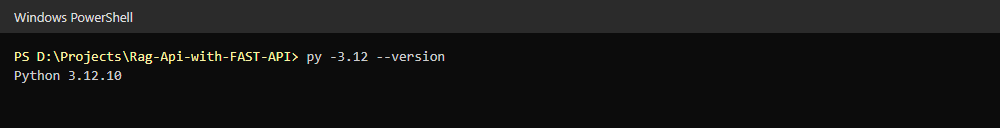
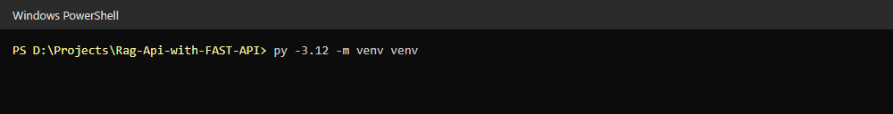
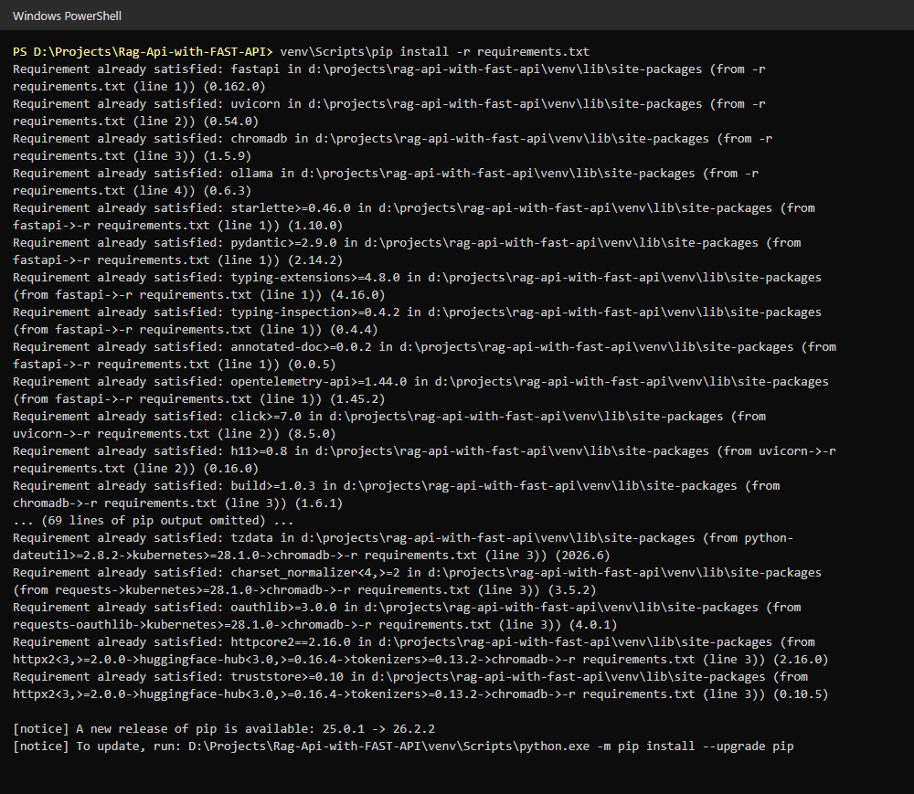
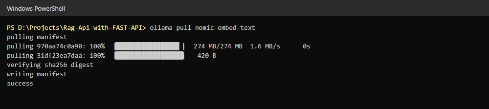
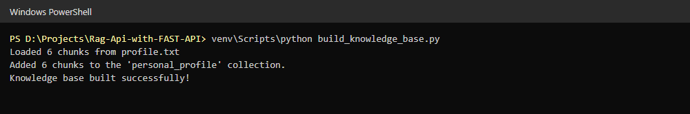
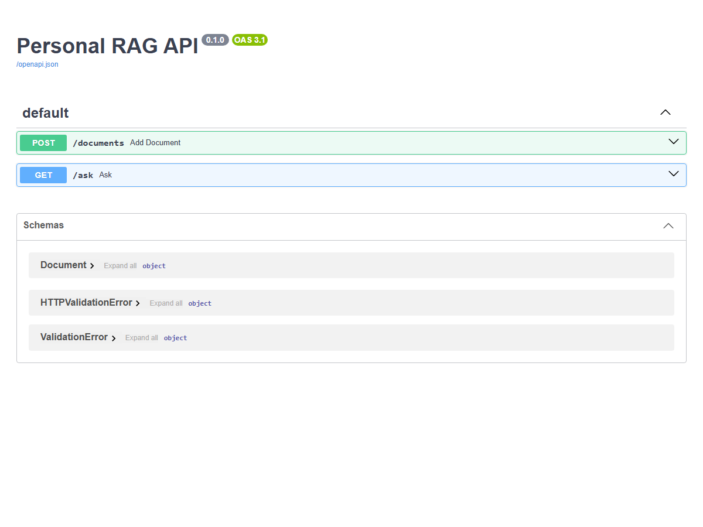
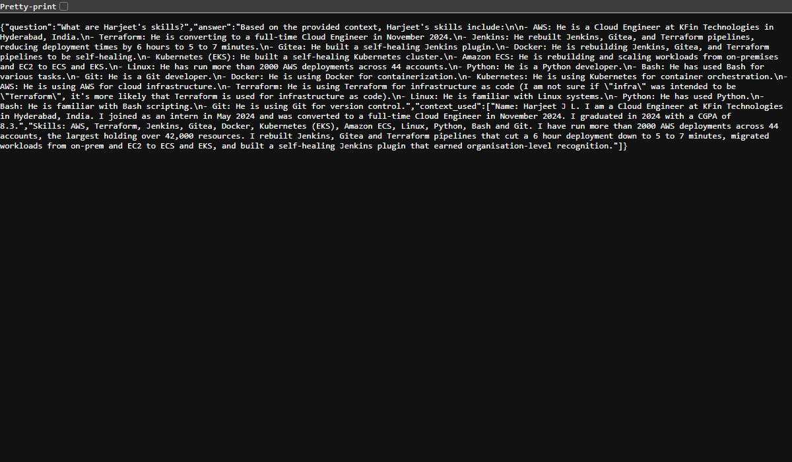
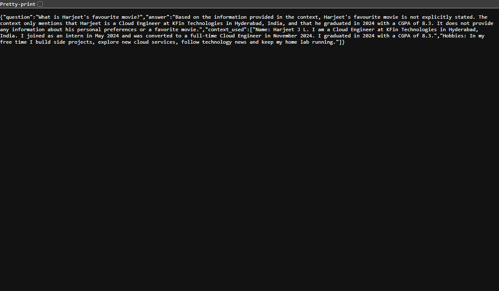
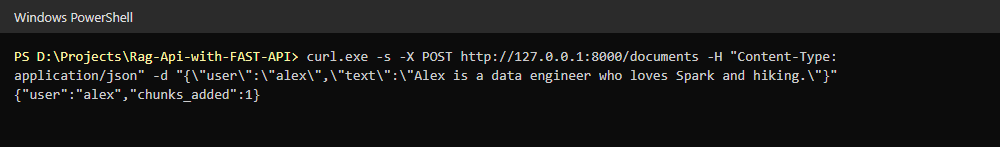
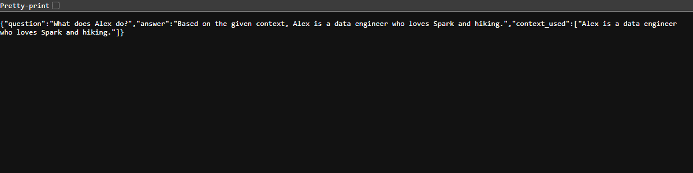

# Screenshots: RAG API with FastAPI, Chroma and Ollama

## 1. Check the Python version
Python 3.12 is used for the virtual environment.

## 2. Create a virtual environment
`py -3.12 -m venv venv` creates `venv/`.

## 3. Install the requirements
Install FastAPI, Uvicorn, ChromaDB and the Ollama client from `requirements.txt` (long pip output trimmed).

## 4. Pull the embedding model
`ollama pull nomic-embed-text` downloads the model used to embed the profile chunks.

## 5. Build the knowledge base
`build_knowledge_base.py` loads 6 chunks from `profile.txt` and stores them in Chroma.

## 6. Open the Swagger docs
With `uvicorn main:app` running, http://127.0.0.1:8000/docs lists `POST /documents` and `GET /ask`.

## 7. Ask about my skills
`GET /ask?question=What are Harjeet's skills?` answers from the retrieved profile chunks.

## 8. Ask something not in the profile
`GET /ask?question=What is Harjeet's favourite movie?` says the context does not contain the answer.

## 9. Add another user's profile
`POST /documents` stores a profile for the user `alex`.

## 10. Ask about the new user
`GET /ask?question=What does Alex do?&user=alex` answers only from Alex's chunks.

